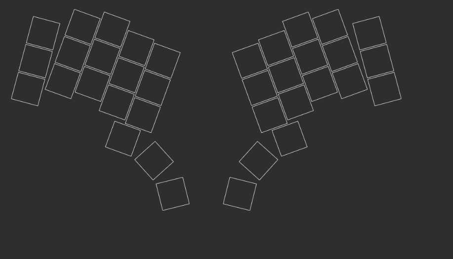
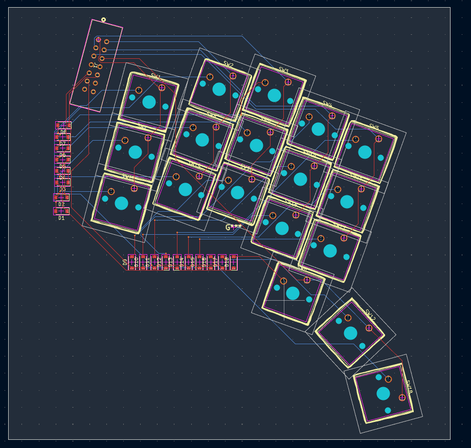
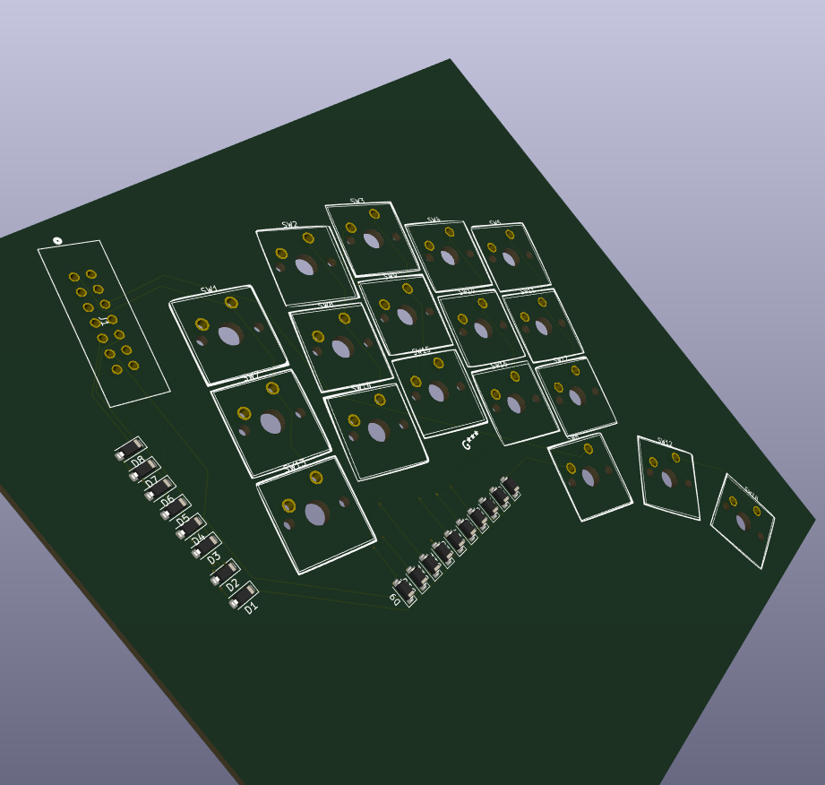
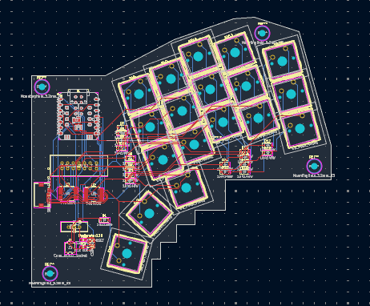
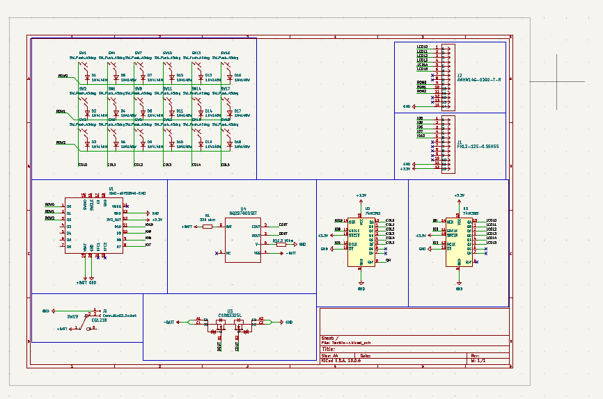

# Tactile

Tactile is a custom split mechanical keyboard for programming, live coding and CAD, with a thumb touchpad for pointer control.

## Why make it?

The aim is a keyboard that feels personal and comfortable during long desk sessions. A split layout lets each hand rest at its own angle, while thumb controls reduce trips between the keyboard and mouse. Tactile switches give clear feedback, and printed keycaps and a case leave room for customization.

## How it works

A wireless controller connects to the computer over Bluetooth. A ribbon cable joins the two halves, and the controller scans the key matrix. The right thumb controls the touchpad; left-thumb keys handle mouse clicks. Layers provide the remaining keyboard functions.

## Challenges so far

Fitting the thumb keys and touchpad into a useful layout has meant balancing comfort with space for the electronics. Another challenge has been choosing a controller and expanding its pins to handle both the keyboard and pointing device. Matching component footprints and keeping the parts affordable still need attention.

The project is in the design stage. The boards and schematics are present; firmware and the physical build are still ahead.

## Design pictures

## Files

Open the left and right projects under `Tactile/PCB/` in KiCad. Custom libraries are in `Tactile/Libraries/`, and printable geometry is in `Tactile/Model/`. The purchase list is also available as [BOM.csv](BOM.csv).

Gerbers and drill files are in the [left fabrication folder](Tactile/PCB/Left%20side/fabrication/) and [right fabrication folder](Tactile/PCB/Right%20side/fabrication/), with a ZIP package for each half. These are design exports; fabrication checks are still pending.

## Purchase BOM

Planned component purchases. Prices are previous supplier estimates for each listed quantity; unquoted prices are marked TBD. Final part selections are still being checked.

| Component | Buy quantity | Price USD | Source |
| --- | --- | --- | --- |
| BLE controller | 1 | 9.90 | [Part](https://www.seeedstudio.com/Seeed-XIAO-BLE-nRF52840-p-5201.html) |
| Tactile switches | 2 packs | 19.98 | [Part](https://en.akkogear.com/product/creamy-purple-u1-switch/) |
| Touchpad | 1 | 9.63 | [Part](https://www.mouser.com/en/ProductDetail/Cirque/TM040040-2024-302?qs=wd5RIQLrsJgMzmw571gvDw%3D%3D) |
| Matrix diodes | 100 | 6.65 | [Part](https://www.digikey.com/en/products/detail/diodes-incorporated/1N4148W-7-F/815280) |
| Shift registers | 2 | 0.60 | [Part](https://www.digikey.com/en/products/detail/nexperia-usa-inc/74HC595D-118/763394) |
| Capacitors | 10 | 0.98 | [Part](https://www.digikey.com/en/products/detail/yageo/CC0805KRX7R9BB104/302874) |
| Touchpad connector | 1 | 2.00 | [Part](https://www.digikey.com/en/products/detail/hirose-electric-co-ltd/FH12-12S-0-5SH-55/1110316) |
| Touchpad cable | 1 | TBD | [Part](https://www.digikey.com/en/products/detail/assmann-wsw-components/AFFC-050-12-051-11/6570261) |
| Ribbon cable | 2 feet | 3.58 | [Part](https://www.digikey.com/en/products/detail/assmann-wsw-components/AWG28-14-F-300/655738) |
| IDC sockets | 2 | 1.20 | [Part](https://www.digikey.com/en/products/detail/assmann-wsw-components/AWP-14-8240-T/5244612) |
| IDC strain reliefs | 2 | 0.20 | [Part](https://www.digikey.com/en/products/base-product/assmann-wsw-components/123/AWZ/567962) |
| IDC headers | 2 | 1.26 | [Part](https://www.digikey.com/en/products/detail/assmann-wsw-components/AWHW-14G-0202-T/5224931) |
| Power switch | 1 | 0.72 | [Part](https://www.digikey.com/en/products/detail/e-switch/EG1218/101726) |
| Battery | 1 | 9.95 | [Part](https://www.digikey.com/en/products/detail/adafruit-industries-llc/258/5054544) |
| USB cable | 1 | 4.95 | [Part](https://www.adafruit.com/product/4474) |
| Battery protection IC | 1 | TBD | [Part](https://www.ti.com/product/BQ2970) |
| Dual MOSFET | 1 | TBD | [Part](https://www.ti.com/product/CSD83325L) |
| 330 ohm resistor | 1 | TBD | To select |
| 2.2 kOhm resistor | 1 | TBD | To select |
| Battery connector | 1 | TBD | [Part](https://www.jst-mfg.com/product/index.php?series=ACH) |
